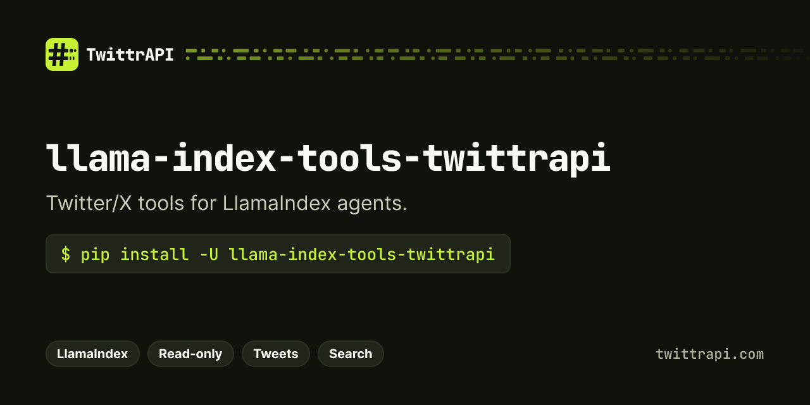

<p align="center">
  <a href="https://twittrapi.com"></a>
</p>

# Twitter/X tools for LlamaIndex agents – TwittrAPI

[](https://pypi.org/project/llama-index-tools-twittrapi/)
[](https://github.com/twittrapi/llama-index-tools-twittrapi/actions/workflows/test.yml)
[](https://pypi.org/project/llama-index-tools-twittrapi/)
[](LICENSE)

`llama-index-tools-twittrapi` is a set of LlamaIndex tools for [TwittrAPI](https://twittrapi.com), a REST API for public Twitter/X data. LlamaIndex agents can read tweets, profiles, followers, search results, lists, communities and trends. Pay as you go from $0.065 per 1,000 calls, no X developer account. Not affiliated with X Corp.

> **Get an API key:** [twittrapi.com/start](https://twittrapi.com/start?utm_source=github&utm_medium=readme&utm_campaign=llama-index-tools-twittrapi) · [Pricing](https://twittrapi.com/pricing?utm_source=github&utm_medium=readme&utm_campaign=llama-index-tools-twittrapi) · [Docs](https://twittrapi.com/docs?utm_source=github&utm_medium=readme&utm_campaign=llama-index-tools-twittrapi) · [Status](https://twittrapi.com/status) · also available on [RapidAPI](https://rapidapi.com/viperscores-viperscores-default/api/twitter-aio)

**SDKs and integrations:** [Python](https://github.com/twittrapi/twittrapi-python) · [Node.js](https://github.com/twittrapi/twittrapi-node) · [Go](https://github.com/twittrapi/twittrapi-go) · [MCP server](https://github.com/twittrapi/twittrapi-mcp) · [n8n](https://github.com/twittrapi/n8n-nodes-twittrapi) · [Make](https://github.com/twittrapi/twittrapi-make) · [Apify](https://github.com/twittrapi/twittrapi-apify) · [LangChain](https://github.com/twittrapi/langchain-twittrapi) · [Agent skill](https://github.com/twittrapi/twittrapi-skills) · [Examples](https://github.com/twittrapi/twittrapi-examples)

All tools are read-only. They are built on the official [`twittrapi`](https://github.com/twittrapi/twittrapi-python) Python SDK.

## Install

```bash
pip install -U llama-index-tools-twittrapi
```

Python 3.10 or newer. Works with `llama-index-core` 0.13 and 0.14.

## Authentication

Use either a direct TwittrAPI key or a RapidAPI key.

```bash
export TWITTRAPI_API_KEY="your-twittrapi-key"   # direct API
# or
export RAPIDAPI_KEY="your-rapidapi-key"         # RapidAPI
```

Or pass the key in code:

```python
from llama_index.tools.twittrapi import TwittrAPIToolSpec

spec = TwittrAPIToolSpec(api_key="your-twittrapi-key")      # direct API
spec = TwittrAPIToolSpec(rapidapi_key="your-rapidapi-key")  # RapidAPI
```

If both environment variables are set, `TWITTRAPI_API_KEY` wins.

Subscribed to another TwittrAPI listing on RapidAPI? Set its host:
`TwittrAPIToolSpec(rapidapi_key="...", rapidapi_host="twttr.p.rapidapi.com")`, or the
`RAPIDAPI_HOST` environment variable.

## Quickstart

### Call a tool directly

```python
from llama_index.tools.twittrapi import TwittrAPIToolSpec

spec = TwittrAPIToolSpec()
print(spec.get_user_by_username("jack"))
```

### Give an agent all the tools

```bash
pip install -U llama-index-llms-anthropic
```

```python
import asyncio

from llama_index.core.agent.workflow import FunctionAgent
from llama_index.llms.anthropic import Anthropic
from llama_index.tools.twittrapi import TwittrAPIToolSpec

agent = FunctionAgent(
    tools=TwittrAPIToolSpec().to_tool_list(),
    llm=Anthropic(model="claude-opus-5-5"),
    system_prompt="You research X (Twitter) with the tools you have. Cite tweet IDs.",
)


async def main() -> None:
    response = await agent.run("What has @jack posted this week? Summarize it.")
    print(response)


asyncio.run(main())
```

Any LLM that supports function calling works. To pick a subset of tools:

```python
tools = TwittrAPIToolSpec().to_tool_list(
    spec_functions=[("search_tweets", "asearch_tweets"), ("get_tweet", "aget_tweet")]
)
```

### Async

Every tool has a sync method (`get_tweet`) and an async one (`aget_tweet`). Agents that run tools asynchronously, such as `FunctionAgent`, use the async methods, which call the SDK's `AsyncTwittrAPI` client and do not block the event loop.

## Tools

| Tool | What it does |
| --- | --- |
| `get_user_by_username` | Profile by handle, including the numeric user ID |
| `get_user_by_id` | Profile by numeric user ID |
| `get_user_tweets` | A user's recent tweets (by `user_id` or `username`) |
| `get_followers` | Accounts that follow a user |
| `get_following` | Accounts a user follows |
| `search_tweets` | Search with X operators (`from:`, `lang:`, `since:`, `min_faves:` ...) |
| `get_tweet` | A tweet with its reply thread |
| `get_tweet_retweets` | Users who retweeted a tweet |
| `get_tweet_quotes` | Tweets that quote a tweet |
| `get_list_tweets` | Tweets from an X list |
| `get_community_tweets` | Tweets posted in an X Community |
| `get_trends` | Trending topics by WOEID (1 = worldwide) |
| `get_trend_locations` | Locations that have trends, with their WOEIDs |

## What the tools return

The tools return the API's [simple format](https://twittrapi.com/docs/simple-format) as compact JSON text: flat, camelCase tweets and users with a fixed schema (`id`, `text`, `author`, `counts`, `media`, ...). It uses far fewer tokens than X's raw JSON. Lists come as `{"data": [...], "nextCursor": ..., "previousCursor": ..., "hasNextPage": ...}`, single objects as `{"data": {...}}`.

For X's raw JSON (every field X sends: cards, polls, edit history, ...), opt out:

```python
TwittrAPIToolSpec(api_response_format="raw")
```

Responses can be large, so each result is cut at `max_chars` characters (default 20,000). When that happens the text ends with a `[TRUNCATED: ...]` marker that says how much was cut.

Paginated tools print the next-page cursor on the first line, before the JSON, so it is never lost to truncation:

```
next_cursor: DAABCgABF...
Pass next_cursor as `cursor` to get the next page.

{"data":[...],"nextCursor":"DAABCgABF...","previousCursor":"...","hasNextPage":true}
```

On the last page (`hasNextPage` is false) the first line says so instead.

Change the limit:

```python
TwittrAPIToolSpec(max_chars=8_000)
```

## Errors

API errors (bad key, no balance, not found, rate limit) and invalid arguments raise `TwittrAPIToolError` with a message that starts with `TwittrAPI error:` or `Invalid arguments:`. LlamaIndex agents catch it and pass the message to the model as a tool error (`ToolOutput.is_error`), so the model can correct itself.

Requests that fail with 429, 5xx or a network error are retried by the SDK.

## Bring your own client

To change timeouts or retries, build the SDK clients yourself and pass them in:

```python
from twittrapi import AsyncTwittrAPI, TwittrAPI
from llama_index.tools.twittrapi import TwittrAPIToolSpec

spec = TwittrAPIToolSpec(
    client=TwittrAPI(api_key="...", timeout=30, max_retries=4),
    async_client=AsyncTwittrAPI(api_key="...", timeout=30, max_retries=4),
)
```

If you pass only `client`, the async methods run it in a worker thread.

## Development

```bash
python -m venv .venv && source .venv/bin/activate
pip install -e . pytest pytest-asyncio
pytest
```

## Support

Questions, bugs or billing: [support@twittrapi.com](mailto:support@twittrapi.com). Issues with this package: [GitHub issues](https://github.com/twittrapi/llama-index-tools-twittrapi/issues).

## License

MIT. See [LICENSE](LICENSE).

Not affiliated with X Corp.
